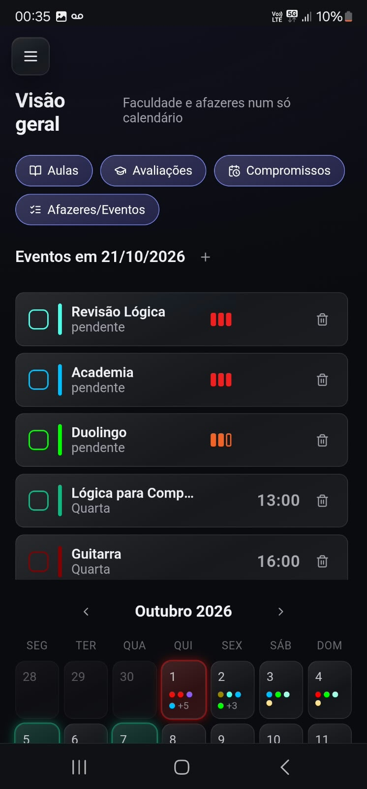
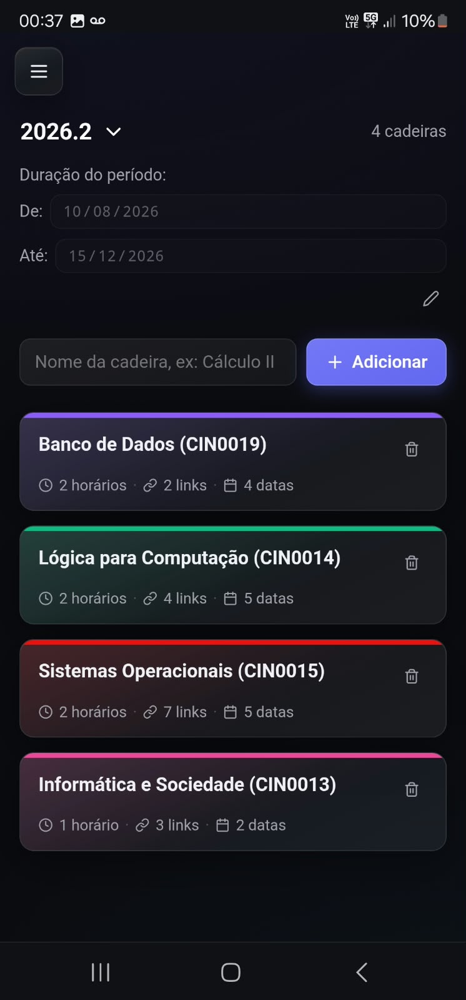
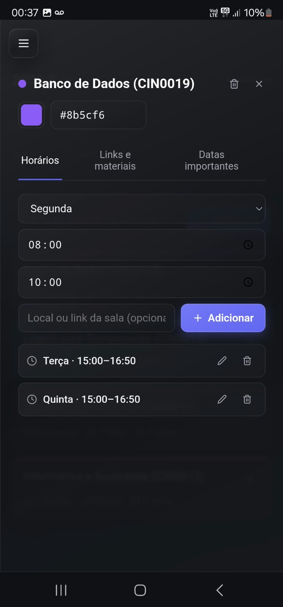
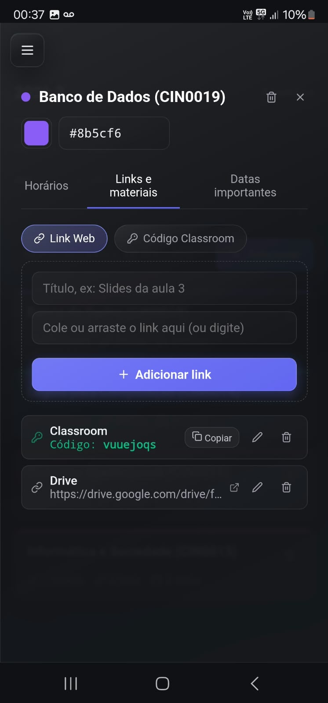
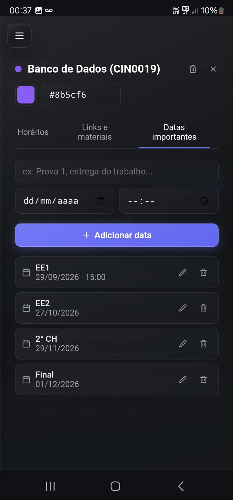
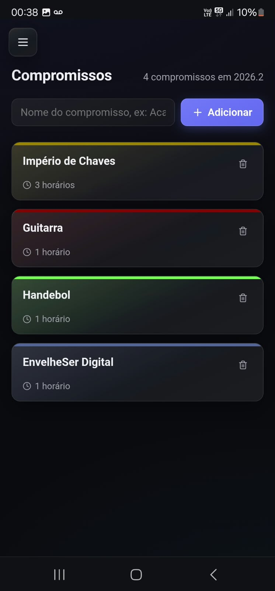
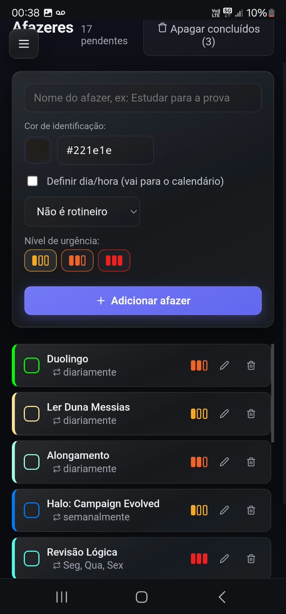
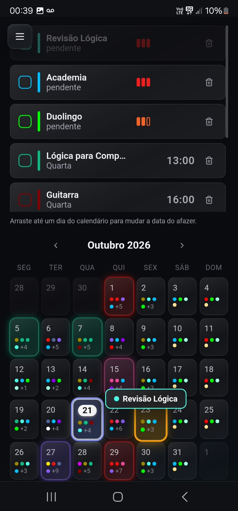
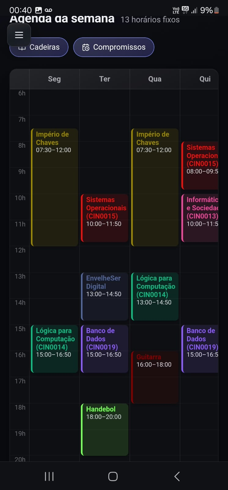
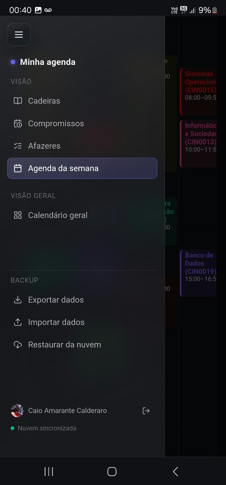

# 📅 Minha Agenda Pessoal

Painel pessoal para organizar a vida acadêmica e a rotina: **períodos, cadeiras, rotinas semanais, compromissos, afazeres e um calendário geral** que cruza tudo isso. Funciona como **PWA** (instalável no celular/desktop), **offline-first** e sincroniza entre dispositivos via **Firebase** quando logado.

<p align="center">
  
</p>
<!-- PLACEHOLDER: print da aba "Calendário geral" com um dia selecionado e o painel de eventos aberto -->

**Stack:** React 18 · Vite 6 · Firebase (Auth + Firestore) · vite-plugin-pwa · Lucide React · CSS puro (dark theme)

---

## Sumário

- [Funcionalidades](#funcionalidades)
- [Como funciona](#como-funciona)
- [Stack](#stack)
- [Como rodar](#como-rodar)
- [Configuração do Firebase](#configuração-do-firebase)
- [Build e deploy](#build-e-deploy)
- [Estrutura do projeto](#estrutura-do-projeto)
- [Decisões técnicas](#decisões-técnicas)
- [Limitações conhecidas](#limitações-conhecidas)

---

## Funcionalidades

### 🎓 Períodos e Cadeiras
- Múltiplos **períodos** (ex.: `2026.1`, `2026.2`) com seletor no próprio título da tela, com criação, renomeação inline e exclusão.
- **Vigência opcional por cadeira** (`dataInicio` / `dataFim`, no drawer da cadeira): aulas e avaliações só aparecem no calendário dentro desse intervalo, e o início/fim ganham uma bandeirinha no calendário geral. Cadeira nova herda a vigência das outras do período.
- Cada **cadeira** tem cor própria, **horários de aula** (dia, início, fim, local), **links/materiais** e **datas importantes** (provas, trabalhos).
- O card (e o topo do painel da cadeira) mostra a **próxima aula** e as **próximas avaliações** em caixas na cor da cadeira (avaliações a uma semana ou menos ficam em destaque), e uma **barra de progresso** com o % concluído da vigência. Cadeira já encerrada fica com caixas cinzas compactas.
- **Tela da cadeira** (toque no card): visualização centralizada na cor da cadeira com quatro abas — **Geral** (mini agenda da semana só com as aulas dela, carga horária, faltas com % do limite e quantas aulas ainda dá para faltar, média), **Materiais** (código do Classroom com copiar e os links como botões), **Datas importantes** (todas, passadas em cinza e próximas em destaque, com o 🔔 de lembretes de cada data) e **Avaliações e Notas** (um boletim por grupo, com a caixa da situação final em verde/âmbar/vermelho).
- A **edição** fica no lápis do card (painel lateral): horários, links (arraste para mudar a ordem), datas e notas em seções recolhíveis.
- Suporte a **códigos de turma do Google Classroom**, sempre listados antes dos links comuns.
- **Faltas:** concluir a aula = presença; o **✗** ao lado da lixeira registra falta (a aula fica concluída com "Falta"). O card mostra as horas de falta contra o limite de 25% da **carga horária** (informada ou estimada pelos horários × vigência), em amarelo/vermelho ao se aproximar.
- **Notas e média:** notas e grupos (unidades) que entram por **peso** (1/1, 60/30/10…) ou como **ponto extra** (lança-se o quanto a nota cresceu: 10 numa mini-prova que vale 1 ponto ⇒ 1; pode passar de 1 ponto). Mostra média parcial, **quanto precisa tirar** nas que faltam para passar direto (≥ 7) ou ir à final (≥ 3), e a nota necessária na final ((média + final)/2 ≥ 5). Uma data importante vira avaliação com um toque, já ligada à nota.

<p align="center">
  
</p>
<!-- PLACEHOLDER: print da aba "Cadeiras" com o grid de cards e o seletor de período aberto -->

<p align="center">
  
  
  
</p>
<!-- PLACEHOLDER: print do drawer lateral de uma cadeira (abas Horários / Links / Datas) -->

### 🔁 Rotinas
- Atividades de toda semana com horário fixo (academia, inglês etc.), vinculadas a um período.
- Card com a **faixa da semana** (dias ativos acesos na cor da rotina), a **próxima ocorrência** e as horas por semana.

### ⭐ Compromissos
- Eventos **pontuais com hora marcada** (dentista, reunião): data, início e fim opcional.
- Marcados com uma **★** no calendário geral; dá para concluir, arrastar para outro dia e apagar os passados.
- Reaproveitam o mesmo editor de horários das cadeiras.

<p align="center">
  
</p>

### ✅ Afazeres
- Afazeres **sem hora**: com uma data, sem data (aparecem em "hoje" até serem concluídos) ou repetidos; **cor livre** e **urgência** em 3 níveis (barra de "bateria").
- **Repetição:** diária, semanal, quinzenal, mensal, **dias específicos da semana** ou intervalo personalizado. A **data de fim** é escolhida num calendário que só mostra os dias possíveis da repetição; vazio = para sempre.
- Lista em seções: Atrasados · Hoje · Próximos · Sem data · Recorrentes · Concluídos.
- Conclusão **por ocorrência** (concluir só o dia de hoje de um afazer recorrente, sem afetar os outros).
- Afazeres com data aparecem automaticamente no calendário geral.

<p align="center">
  
</p>
<!-- PLACEHOLDER: print da aba "Afazeres" mostrando o formulário e a lista com urgência/rotina -->

### 📆 Calendário geral
- Visão mensal que **cruza aulas, avaliações, rotinas, compromissos e afazeres**, com filtros por tipo.
- **Marcadores** no canto do dia: ★ compromisso, 📖 avaliação, bandeiras de início/fim de cadeira (vários do mesmo tipo = número).
- Abre com o dia atual selecionado e painel de detalhes do dia.
- **Arrastar e soltar** ocorrências de afazeres para outro dia (mouse, e toque com *long-press*), com troca automática de mês ao arrastar até a borda.
- Em afazeres recorrentes, mover uma ocorrência **não altera a regra**: a exceção é guardada só para aquela data.
- Marcar eventos como concluídos e **excluir apenas uma ocorrência** (ex.: aula cancelada) sem apagar o horário.

<p align="center">
  
</p>
<!-- PLACEHOLDER: print/GIF do drag-and-drop de um afazer entre dias do calendário -->

### 🧭 Agenda da semana
- Grade semanal (06h–23h) combinando horários de cadeiras e rotinas, com filtro por origem.
- Clicar num bloco abre o painel de edição correspondente.
- **Conflitos de horário** (aula × rotina) aparecem lado a lado com ⚠; o painel avisa ao cadastrar um horário que choca, sem bloquear.
- Lista de próximas datas importantes.

<p align="center">
  
</p>
<!-- PLACEHOLDER: print da aba "Agenda da semana" com a grade preenchida -->

### 🏅 Certificados
- Todos os certificados (faculdade, eventos, monitorias, cursos, idiomas) num lugar só: busca por título, **tags criadas por você** com filtro, cor por item; tocar na linha mostra **Abrir** e **Baixar PDF** (imagem é convertida em PDF no próprio aparelho).
- Os arquivos (PDF, imagem, Word, PowerPoint; até 20 MB) ficam no **Firebase Storage**. Os dados do app guardam só um registro leve com o link, e o SDK do Storage só é baixado ao enviar, então a abertura do app não pesa.
- Excluir ou trocar um arquivo tem "Desfazer": ele só é apagado de verdade depois de 30 dias.

### ☁️ Sincronização e backup
- **Sem login:** dados salvos em `localStorage`.
- **Com login Google:** sincronização em tempo real entre dispositivos via Firestore, com indicador de status (salvo, salvando, offline, erro) e horário da última sincronização.
- **Backups em 2 camadas:**
  - Snapshots na nuvem a cada 3h (últimos 10), com restauração pela Sidebar.
  - Exportar/importar `.json` manual.

<p align="center">
  
</p>
<!-- PLACEHOLDER: print da sidebar mostrando seção Backup, conta logada e status "Nuvem sincronizada" -->

### 🔔 Lembretes
- Notificações push de **compromissos** e **avaliações**, mesmo com o app fechado (Android, desktop e iPhone com o app instalado).
- Padrões globais (ex.: 15 min antes de compromissos, 1 dia antes de provas) e lembretes próprios por item ("Na hora", "1 h", "1 semana", "Nenhum"…). Avaliações têm liga/desliga **por data** (desligado por padrão), com tempos personalizados (valor em horas, dias ou semanas).
- Uma Cloud Function agendada roda a cada minuto, calcula o que venceu com a **mesma lógica pura** do app (`utils/lembretes.js`) e envia pelo Firebase Cloud Messaging.

### 📱 PWA e UX
- Instalável (Android, iOS, desktop) e funciona offline.
- Layout responsivo: abaixo de 860px a sidebar vira menu deslizante.
- Navegação por **Enter** em formulários e painéis (avança o foco e aciona botões), útil para cadastro rápido só no teclado.

---

## Como funciona

### Modelo de dados

Todo o estado é um único objeto (`AppData`), persistido como um documento só:

```ts
type AppData = {
  versao: number;                 // versão do schema (migrações em utils/migracoes.js)
  periodos: Periodo[];            // { id, nome }
  cadeiras: Cadeira[];            // { id, periodoId, nome, cor, dataInicio?, dataFim?, horarios[], links[], datas[] }
  rotinas: Rotina[];              // { id, nome, cor, horarios[], dataInicio?, dataFim? }
  compromissos: Compromisso[];    // { id, nome, cor, data, inicio, fim?, feito, lembretes? }
  lembretes: { compromissos: number[]; avaliacoes: number[] };  // padrões (minutos antes)
  afazeres: Afazer[];             // { id, nome, data?, rotina{ tipo, dataFim?, ... }, urgencia, feito, cor?, ... }
  eventosConcluidos: string[];    // chaves de ocorrências marcadas como concluídas
  eventosExcluidos: string[];     // chaves de ocorrências removidas (ex.: aula cancelada)
  certificados: Certificado[];    // { id, titulo, cor, tags[], arquivo{ caminho, url, ... }, criadoEm } (arquivo no Storage)
  tagsCertificados: Tag[];        // { id, nome }
  arquivosParaApagar: { caminho: string; desde: number }[];  // lixeira de 30 dias
  periodoAtivoId: string | null;
};
```

### Recorrência calculada sob demanda
Ocorrências futuras **nunca são persistidas**. Aulas e rotinas são projetadas dia a dia em `utils/projecao.js` (memoizado por `useEventosCalendario`); afazeres rotineiros usam `ocorrenciasNoIntervalo()` (`utils/afazeres.js`). Exceções (concluído, excluído, movido) ficam em listas/mapas indexados pela data da ocorrência.

### Camada de persistência (`usePersistedData`)
Todo write do app passa por `persist()`, que decide o destino:

| Estado | Destino | Leitura |
|---|---|---|
| Não logado | `localStorage` | Na inicialização |
| Logado | Firestore `users/{uid}` | Checagem inicial no servidor + `onSnapshot` em tempo real |

Proteções contra perda de dados:
- **Leitura inicial forçada no servidor** (`getDocFromServer`, com timeout de 8s) antes de decidir criar o documento, para não sobrescrever dados reais com um "não existe" vindo do cache.
- **Fila de escrita serializada**: `setDoc` é encadeado para que respostas de rede fora de ordem não apaguem alterações mais novas.
- **Trava anti-sobrescrita**: `persist()` recusa gravar um estado que sanitiza para "vazio" por cima de um estado com conteúdo.
- **`sanitizarDados`** como fonte única de normalização (campos ausentes, tipos inválidos, retrocompatibilidade com backups antigos).
- **Fallback offline:** se o servidor não responde, usa o cache persistente do Firestore (IndexedDB) e o SDK sincroniza as escritas pendentes ao reconectar.

### Autenticação
Login via Google (popup). O acesso é restrito a **um único e-mail** definido em `EMAIL_PERMITIDO` (`src/firebase.js`); qualquer outra conta é deslogada automaticamente.

> ⚠️ A trava de e-mail no client é só conveniência. A segurança real depende das **Firestore Security Rules** (veja abaixo).

---

## Stack

| Camada | Tecnologia |
|---|---|
| UI | React 18, Lucide React, CSS puro |
| Build | Vite 6 |
| Testes | Vitest 4 |
| PWA | vite-plugin-pwa (Workbox, `autoUpdate`) |
| Auth e dados | Firebase Auth (Google) + Firestore (cache persistente) |
| Persistência local | `localStorage` + IndexedDB (via Firestore) |

---

## Como rodar

**Pré-requisitos:** [Node.js](https://nodejs.org) 18+ e npm.

```bash
# 1. Clone o repositório
git clone https://github.com/<seu-usuario>/<nome-do-repo>.git
cd <nome-do-repo>

# 2. Instale as dependências
npm install

# 3. Configure as variáveis de ambiente
cp .env.example .env
# edite o .env com as credenciais do seu projeto Firebase

# 4. Rode em desenvolvimento
npm run dev
```

Abra `http://localhost:5173`.

> O app **inicializa o Firebase ao carregar**, então o `.env` precisa estar preenchido mesmo que você só vá usar o modo local (sem login). Sem ele, o SDK falha na inicialização.

---

## Configuração do Firebase

1. Crie um projeto no [Firebase Console](https://console.firebase.google.com).
2. Em **Authentication → Sign-in method**, ative o provedor **Google**.
3. Em **Authentication → Settings → Authorized domains**, adicione o domínio de produção (ex.: `seu-app.vercel.app`). `localhost` já vem autorizado.
4. Em **Firestore Database**, crie o banco.
5. Em **Project settings → Your apps**, registre um app Web e copie as credenciais para o `.env`:

```env
VITE_FIREBASE_API_KEY=
VITE_FIREBASE_AUTH_DOMAIN=
VITE_FIREBASE_PROJECT_ID=
VITE_FIREBASE_STORAGE_BUCKET=
VITE_FIREBASE_MESSAGING_SENDER_ID=
VITE_FIREBASE_APP_ID=
```

6. Troque o e-mail permitido em `src/firebase.js`:

```js
export const EMAIL_PERMITIDO = "seu-email@exemplo.com";
```

7. **Obrigatório:** publique as **Security Rules** versionadas em [`firestore.rules`](firestore.rules). Elas restringem cada documento ao próprio `uid` **e** ao e-mail permitido (troque o e-mail lá também), validam o formato mínimo dos dados, impedem apagar o documento principal e só permitem criar/apagar backups:

```bash
# troque o projeto em .firebaserc pelo seu
firebase deploy --only firestore:rules
```

8. **Lembretes (opcional, exige o plano Blaze):** publique a Cloud Function agendada em [`functions/`](functions). O predeploy copia `src/utils/lembretes.js` para `functions/compartilhado/`:

```bash
cd functions && npm install && cd ..
firebase deploy --only functions,firestore:rules
```

9. **Certificados (opcional, exige o plano Blaze):** ative o **Storage** no console do Firebase e publique as regras de [`storage.rules`](storage.rules) (troque o e-mail lá também):

```bash
firebase deploy --only storage
```

   Para o botão **Baixar** funcionar, libere a leitura do bucket pelo navegador (CORS, uma vez só). Não faz parte das regras: no [Cloud Shell](https://shell.cloud.google.com) (ou com o `gcloud` instalado), crie um `cors.json` com o conteúdo de [`storage.cors.json`](storage.cors.json) e rode:

```bash
gcloud storage buckets update gs://SEU_BUCKET --cors-file=cors.json
```

   O CORS não dá acesso a ninguém: cada arquivo continua exigindo o link com o token secreto dele ou o login do dono.

> As chaves `VITE_FIREBASE_*` são públicas por natureza (vão para o bundle do client). Usar `.env` aqui serve para facilitar a troca de projeto e não commitar credenciais, **não** para escondê-las. A proteção real são as Security Rules.

---

## Build e deploy

```bash
npm test          # testes (Vitest)
npm run check     # lint + testes + build
npm run format    # formata o código (Prettier)
npm run build     # gera dist/
npm run preview   # serve o build localmente
```

Deploy estático em qualquer provedor (Vercel, Netlify, Firebase Hosting). Na Vercel/Netlify, cadastre as variáveis `VITE_FIREBASE_*` no painel do projeto e adicione o domínio final em *Authorized domains* do Firebase Auth.

---

## Estrutura do projeto

```
src/
├── App.jsx                  # Estado global, ações CRUD, backup, roteamento de abas
├── firebase.js              # Config Firebase, login Google, e-mail permitido
├── arquivos.js              # Arquivos dos certificados no Firebase Storage
├── notificacoes.js          # Registro do aparelho no FCM (lembretes)
├── sw.js                    # Service worker: cache offline + push dos lembretes
├── constants.js             # Cores, dias, rotinas, chaves de storage
├── hooks/
│   ├── usePersistedData.js  # Persistência híbrida (local / Firestore), fila de escrita, offline
│   ├── useEventosCalendario.js  # Memoiza a projeção do mês (utils/projecao.js)
│   ├── useFiltrosCalendario.js  # Filtros do calendário (persistidos)
│   ├── useCloudBackup.js    # Snapshots no Firestore a cada 3h
│   └── useNavegacaoEnter.js # Navegação por Enter em formulários
├── utils/
│   ├── sanitizarDados.js    # Normalização única dos dados persistidos
│   ├── afazeres.js          # Cálculo de recorrência
│   ├── calendario.js        # Células do mês, vigência da cadeira
│   └── ...
└── components/
    ├── Sidebar.jsx
    ├── VisaoGeral.jsx       # Calendário mensal + drag-and-drop
    ├── VisaoAgenda.jsx      # Grade semanal
    ├── VisaoCadeiras.jsx / VisaoRotinas.jsx / VisaoCompromissos.jsx / VisaoAfazeres.jsx / VisaoCertificados.jsx
    ├── PainelCadeira.jsx / PainelRotina.jsx   # Drawers de edição
    ├── abas/                # Horários, Links, Datas
    └── ui/                  # SeletorData, SeletorCor, SecaoLista, ResumoCadeira/Rotina, ...
```

---

## Decisões técnicas

- **Sem gerenciador de estado externo:** um único objeto `AppData` + `persist()` centralizado basta para o escopo e garante que toda escrita passe pela camada de sincronização.
- **Sem ocorrências persistidas:** recorrência é derivada; só exceções são salvas. Evita dados inconsistentes quando a regra muda.
- **Edição atômica de listas:** itens são editados com um único `.map()` por `id`, nunca "remover + adicionar" em duas chamadas (causava duplicatas por closure sobre array desatualizado).
- **Offline-first sem reinventar sincronização:** o cache persistente do Firestore cuida da fila de escritas pendentes.
- **Lembretes sem duplicar regra:** a função do servidor usa uma cópia byte a byte de `utils/lembretes.js` (checada nos testes), então o que o app mostra e o que o servidor envia nunca divergem.
- **CSS puro:** sem framework de UI, por ser um projeto de escopo pequeno.

---

## Limitações conhecidas

- **Single-user:** o acesso é restrito a um e-mail fixo no código. Multiusuário exigiria remover essa trava (as Rules já isolam por `uid`).
- **Cache do Firestore em modo single-tab** (`persistentSingleTabManager`): o uso offline simultâneo em várias abas do mesmo navegador não é coordenado.
- **Testes só da lógica pura** (Vitest, `npm test`): recorrência, calendário, sanitização e integridade do projeto. Componentes React ainda não são testados.

---

## Licença

Projeto pessoal, publicado para fins de portfólio. 

<div align="center">

Feito por **[Caio Amarante Calderaro](https://github.com/IrineuACgasoso)**

</div>